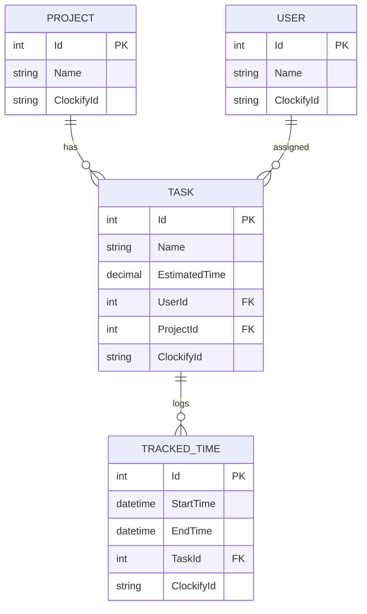

# TaskTracker API

A RESTful API built with **ASP.NET Core 8**, **Entity Framework Core**, and **MySQL** for managing projects, tasks, and tracked hours, featuring synchronization with the **Clockify API**.

---

## Quick Start Guide

### Prerequisites
- [.NET 8 SDK](https://dotnet.microsoft.com/download/dotnet/8.0)
- [MySQL Server](https://dev.mysql.com/downloads/mysql/)
- [Clockify Account](https://clockify.me/) (API Key & Workspace ID)

### Setup & Run

1. **Clone the repository:**
   ```bash
   git clone <repo-url>
   cd TaskTracker
   ```

2. **Configure Database Connection:**
   Update the connection string in `appsettings.json`:
   ```json
   "ConnectionStrings": {
     "AppDbContext": "Server=127.0.0.1;port=3306;user=root;password=your_password;Database=task_tracker_db"
   }
   ```

3. **Set Clockify Secrets:**
   ```bash
   dotnet user-secrets set "Clockify:ApiKey" "<YOUR_CLOCKIFY_API_KEY>"
   dotnet user-secrets set "Clockify:WorkspaceId" "<YOUR_WORKSPACE_ID>"
   ```

4. **Apply Migrations:**
   ```bash
   dotnet ef database update
   ```

5. **Run the Application:**
   ```bash
   dotnet run
   ```
   Open Swagger UI at: `https://localhost:7299/swagger` or `http://localhost:5263/swagger`.

---

## Database Model



---

## API Endpoints

### Projects (`/api/Projects`)
| Method | Endpoint | Description |
|---|---|---|
| `GET` | `/api/Projects` | Get all projects |
| `GET` | `/api/Projects/{id}` | Get project by ID |
| `POST` | `/api/Projects` | Create project (syncs to Clockify) |
| `PUT` | `/api/Projects/{id}` | Update project (syncs to Clockify) |
| `DELETE` | `/api/Projects/{id}` | Delete project |

### Tasks (`/api/Tasks`)
| Method | Endpoint | Description |
|---|---|---|
| `GET` | `/api/Tasks` | Get all tasks |
| `GET` | `/api/Tasks/{id}` | Get task by ID |
| `POST` | `/api/Tasks` | Create task (syncs to Clockify) |
| `PUT` | `/api/Tasks/{id}` | Update task (syncs to Clockify) |
| `DELETE` | `/api/Tasks/{id}` | Delete task |
| `GET` | `/api/Tasks/export-csv` | Export CSV report (estimated vs. actual hours) |

### Tracked Times (`/api/TrackedTimes`)
| Method | Endpoint | Description |
|---|---|---|
| `GET` | `/api/TrackedTimes` | Get all time entries |
| `POST` | `/api/TrackedTimes` | Log time entry (syncs to Clockify) |
| `PUT` | `/api/TrackedTimes/{id}` | Update time entry (syncs to Clockify) |
| `DELETE` | `/api/TrackedTimes/{id}` | Delete time entry |

### Users (`/api/Users`)
| Method | Endpoint | Description |
|---|---|---|
| `GET` | `/api/Users` | Get all users |
| `GET` | `/api/Users/{id}` | Get user by ID |
| `POST` | `/api/Users/sync` | Sync users from Clockify workspace |
| `PUT` | `/api/Users/{id}` | Update user |
| `DELETE` | `/api/Users/{id}` | Delete user |
